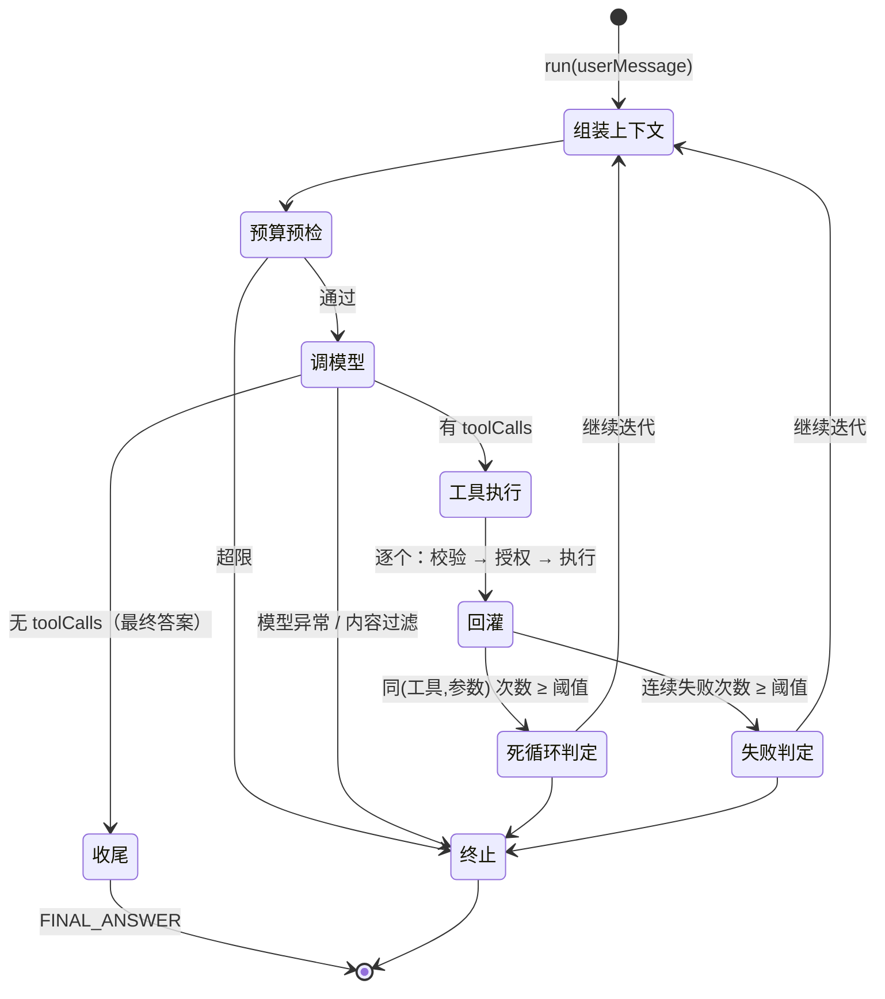

# Agent Loop · 状态与记忆 · 工作流编排 · 多 Agent 协作

> 对应 JD：「理解 Agent Loop 的运转机制和 Harness Engineering 的核心思想，有**工具调用、状态与记忆、权限控制、工作流编排、Agent 运行时或多 Agent 协作**相关实践经验」。
>
> 本模块的原则：**只用 JDK 17 标准库 + Jackson；全离线可跑；没有 API Key、没有外网也能完整运行与回归。**
> 所有「模型」都是确定性替身，所以每一条结论都能被单元测试钉死，而不是靠「看起来对」。

---

## 〇、模块地图

| 包 | 关键类 | 一句话职责 |
|---|---|---|
| `agent` | `ToolRegistry` | 工具注册 + 入参校验 + 给模型看的声明列表 |
| `agent` | `AgentLoop` | 迭代协议：组装 → 调模型 → 授权执行 → 回灌 → 终止判定 |
| `agent` | `AgentResult` / `AgentStep` / `ToolInvocation` | 一次运行的完整档案（可复盘、可统计） |
| `agent` | `TerminationReason` | 终止原因的**分类学**（失败必须可归因） |
| `agent` | `TokenBudgetMeter` | 模块内的最小计量器（生产用 harness 包的实现） |
| `agent.tools` | `CalculatorTool` / `KnowledgeSearchTool` / `ReadFileTool` / `SqlQueryTool` / `CurrentTimeTool` | 五个内置工具，全部声明 `SideEffect` |
| `agent.memory` | `ConversationState` / `MemoryCompactor` | 短期上下文 + 超预算压缩 |
| `agent.memory` | `Scratchpad` / `MemoryStore` | 长期笔记（JSONL）/ 事实记忆（KV + TTL + 模糊匹配） |
| `agent.workflow` | `Workflow` / `WorkflowNode` / `WorkflowRunner` / `RetrievalWorkflow` | 有向图 + 条件边 + 节点级重试 + 整体 Trace |
| `agent.multi` | `SpecialistAgent` / `SupervisorAgent` / `Planner` | 专家（工具集/提示/记忆隔离）+ 主管（分派/汇总/再委派） |
| `agent.lab` | `AgentLab.run()` | 六项实验串成一份可打印的实验报告 |

---

## 一、Agent Loop 运转机制（逐帧拆解）

### 1.1 状态机



用 ASCII 再画一遍（面试白板版）：

```
        ┌──────────────────────────────────────────────────────────┐
        │                                                          │
        ▼                                                          │
   ┌─────────┐   预算   ┌──────────┐   校验/授权/执行   ┌────────┐ │
   │ 组装上下文 │─▶(超限)─▶│ 预算熔断  │                  │ 工具执行 │ │
   │(超预算先压)│         └──────────┘                  └───┬────┘ │
   └────┬────┘                                               │      │
        │  组装 ChatRequest                                    │回灌   │
        ▼                                                     ▼      │
   ┌─────────┐   无 toolCalls   ┌──────────┐            ┌────────┐   │
   │  调模型  │────────────────▶│ 收尾收答案 │            │ 回灌结果 │   │
   │         │◀────────────────│          │            └────┬───┘   │
   └────┬────┘   有 toolCalls    └──────────┘                 │      │
        │                                                  死循环/失败判定
        │                                                      │
        └──────────────────── 继续迭代 ◀────────────────────────┘
```

### 1.2 一帧（一次迭代）到底发生了什么

以「模型请求调用 `calculator`」为例，七个动作：

| # | 动作 | 代码位置 | 为什么这么做 |
|---|---|---|---|
| 1 | **组装上下文** | `ConversationState.context()` | 超预算先压缩再发模型；压缩失败必须降级，不能让「压缩」成为新的故障点 |
| 2 | **预算预检** | `AgentLoop.budgetVerdict()` | 在**调用模型之前**问「还能再花吗」；预算不是事后报表，是运行时硬约束 |
| 3 | **调模型** | `ChatModel.chat()` | 模型异常被捕获，转成 `StopReason.ERROR`，不让异常炸掉链路 |
| 4 | **计量** | `UsageMeter.charge()` | token/成本在调用路径上累加，不是靠日志离线聚合 |
| 5 | **执行工具** | 校验 → 授权 → 执行 | 见 §三；**授权必须发生在执行之前** |
| 6 | **回灌** | `ChatMessage.toolResult(callId, name, content)` | 结果必须带 `toolCallId`，否则模型无法把结果对齐到调用；失败也要回灌（结构化错误） |
| 7 | **终止判定** | 五个条件 | 见 §1.3 |

### 1.3 终止条件（每一条都对应一种真实故障）

| 终止原因 | 触发条件 | 对应的线上故障 |
|---|---|---|
| `FINAL_ANSWER` | 模型不再请求工具 | 正常收敛 |
| `MAX_STEPS` | 达到步数上限仍未收敛 | 模型跑偏 / 任务本身不可完成 |
| `BUDGET_EXCEEDED` | token 或成本预算耗尽 | 无限循环把预算烧光 |
| `LOOP_DETECTED` | 同一 (工具, 参数) 重复 ≥ 阈值 | 模型陷入「反复调同一个工具」的死循环 |
| `CONSECUTIVE_TOOL_FAILURES` | 连续工具失败 ≥ 阈值 | 工具本身坏了，或模型参数一直不对 |
| `MODEL_ERROR` | 模型调用异常 | 上游 5xx / 超时 / 限流 |
| `MODEL_TRUNCATED` | `max_tokens` 截断 | 答案可能不完整，需要提示用户 |
| `CONTENT_FILTERED` | 内容安全过滤 | 合规拦截 |

**为什么「重复调用」要单独判定？**
步数上限太粗（一次合法循环可能跑很多步）；「连续失败」抓不到「工具成功但模型不收尾」。
只有「同一工具 + 同一组参数」才是死循环的可靠指纹——
注意是**同一组参数**：合法的「查第 1 页、查第 2 页」参数不同，不该被误伤。

### 1.4 两个关键设计取舍

**取舍 A：工具异常 → 结构化错误回灌，而不是抛出去。**
工具失败是 Agent 的正常分支（文件不存在、参数非法、外部接口超时）。
异常一旦冒泡到模型层，Agent 就失去了「知道自己失败」的能力，既不能重试也不能换路，只能整体崩掉。
本模块的做法：`ToolResult.error(code, message)` → 以 `role=TOOL` 消息回灌 → 模型自己决定重试、换路或如实告知用户做不到。
> 配套要求：**错误码必须稳定**（`PERMISSION_DENIED` / `INVALID_ARGUMENTS` / `TOOL_EXECUTION_FAILED` / `SQL_FORBIDDEN` …），
> 这样才能按失败类型做统计与告警。

**取舍 B：校验 / 授权 / 执行，三步分离且顺序固定。**
模型给的参数是不可信输入。`ToolRegistry` 用 `ToolSpec.parameters()` 这**一份声明**同时做「喂给模型的 schema」和「运行时校验」，
避免「模型以为能传 `retries`、代码却当未知参数丢掉」这类漂移；而这份漂移在离线测试里完全看不出来。

---

## 二、状态与记忆：三种形态与取舍

| 形态 | 实现 | 生命周期 | 容量约束 | 典型内容 | 读写方式 |
|---|---|---|---|---|---|
| **短期 / 工作记忆** | `ConversationState` | 一次会话 | token 预算 | 当前对话轮次、工具结果 | 全量进上下文，超预算即压缩 |
| **长期 / 情景记忆** | `Scratchpad` | 进程 / 文件 | 几乎无限 | 「做过什么」：实验记录、关键动作 | JSONL 追加，只写不改 |
| **长期 / 语义记忆** | `MemoryStore` | 业务定义 | 条数可控 | 「是什么」：用户偏好、风险等级 | 按 key 精确取 + 模糊召回 |

### 2.1 为什么是三种而不是一种

| 维度 | 短期 | 情景 | 语义 |
|---|---|---|---|
| 访问方式 | 全量扫描，**每次都要进上下文** | 追加写，按需回读 | 按 key 精确读 + 语义召回 |
| 存储成本 | 高（每轮都要重新发送） | 极低（写一次） | 中（要维护索引/作用域） |
| 一致性 | 强（单一真源） | 追加式，天然可审计 | 弱（TTL 过期、可能冲突） |
| 风险 | **撑爆上下文** | 无限膨胀、噪声 | 陈旧事实误导模型 |

把它们混在一起（比如全塞进一个向量库）的后果是：
每轮都要把「三天前的实验流水账」和「当前这一句话」一起发给模型，既贵又降质。

### 2.2 压缩策略的取舍

`MemoryCompactor` 把最早的若干轮压成摘要，有三条硬约束：

1. **摘要与原文分开存放**。若把摘要当普通消息塞回列表，下一次压缩会把「上一次的摘要」再摘要一遍，
   出现摘要套摘要、上下文越压越涨的经典 bug。本模块把摘要单独放在 `ConversationState.summary` 字段，
   压缩是**单向且幂等**的。
2. **模型不可用必须降级**。摘要模型抛异常 / 返回空 → 退化为「截断式摘要」。
   *压缩本身不能成为新的失败点*，否则上下文一长 Agent 就整体挂掉。
3. **摘要用 assistant 角色**。摘要来自本会话自身的历史，不是外部不可信输入；
   用 assistant 可以避免在对话中途插入新的 system 指令——那等于给「历史内容里的指令」升级成系统指令的机会。

### 2.3 Scratchpad 为什么用 JSONL 而不是 JSON 数组

JSON 数组每次写入都要「读全量 → 反序列化 → 追加 → 写全量」，进程崩了就丢最后一段。
JSONL 是**纯追加**：崩溃最多丢最后一行，而且天然支持流式读取与 grep 式排查。
Agent 的长期笔记恰恰是「随时可能崩」的运行时数据，所以选 JSONL。父目录不存在时自动创建。

### 2.4 事实记忆的 scope

`MemoryStore.Scope.SESSION`（随会话失效）与 `Scope.USER`（跨会话共享）。
多 Agent 场景里 scope 是**必须的**：检索专家记的东西不该污染写作专家的记忆。
查询支持 TTL（过期即失效）与模糊匹配（`core.Text.jaccard`）——
模型提问的措辞和当初写入事实时的措辞几乎不会完全一致（「用户叫什么」vs「客户姓名」）。
没有 embedding 的离线环境里，Jaccard 是一个足够好用的折中；生产环境应换成向量检索。

---

## 三、权限控制：授权发生在执行之前

### 3.1 三道防线，顺序固定

```
模型发起调用
   │
   ├─① 参数校验   ToolRegistry.validate()   缺必填 / 类型不符 / 未知参数 / 工具不存在
   │              └─ 不过 → ToolResult.error(INVALID_ARGUMENTS…) 回灌，不执行
   ▼
   ├─② 授权      ToolAuthorizer.authorize() 返回 null = 放行，非 null = 拒绝理由
   │              └─ 拒绝 → ToolResult.error(PERMISSION_DENIED, 理由) 回灌，不执行
   ▼
   └─③ 执行      Tool.execute()，内部再做沙箱校验（如 ReadFileTool 的路径规范化）
                  └─ 抛异常 → ToolResult.error(TOOL_EXECUTION_FAILED) 回灌，不炸链路
```

**拒绝理由必须回灌给模型**：模型才知道「这条路走不通」，可以换工具、换路径，
或如实告诉用户做不到——而不是崩掉，或者偷偷绕过。

### 3.2 沙箱的两道校验（以 `ReadFileTool` 为例）

| 防线 | 拦什么 | 做法 |
|---|---|---|
| 字符串级 | `../` 穿越、绝对路径 | `root.resolve(p).normalize().startsWith(root)` |
| 真实路径级 | 沙箱内的软链接指向沙箱外 | `toRealPath()` 后再比一次根目录 |

只做字符串检查的实现基本都会被软链接绕过——这是文件沙箱最经典的漏洞。
此外还有**大小上限**（防止模型请求读 2GB 日志把进程内存打爆）。

### 3.3 副作用等级不是装饰

每个工具都声明 `ToolSpec.SideEffect`（`READ_ONLY` / `WRITE` / `NETWORK`），
权限策略据此决定是否需要审批。
**副作用等级声明错了，权限系统就形同虚设**——把一个会写文件的工具标成 `READ_ONLY`，
任何按等级放行的策略都会放它过去。

### 3.4 工具能力边界的三条自证

| 工具 | 边界 | 自证方式 |
|---|---|---|
| `CalculatorTool` | 只认数字与 `+ - * / ( )` | 自己写递归下降解析器，**不用 eval / ScriptEngine**（那等于把模型输出当代码执行 = RCE） |
| `SqlQueryTool` | 只认 `SELECT` | 白名单解析器，不认识任何写语法；DDL/DML 在解析阶段拒绝 |
| `ReadFileTool` | 沙箱根目录内 | 规范化 + 真实路径双校验 + 大小上限 |

---

## 四、工作流编排与 Agent Loop 的职责边界

### 4.1 一句话分工

> **确定性的流程用工作流编排，不确定的探索用 Agent Loop。**

| 维度 | Agent Loop | 工作流 |
|---|---|---|
| 控制流由谁决定 | **模型** | **代码**（图 + 条件边） |
| 步骤是否可预知 | 否（模型可能调任何工具） | 是 |
| 失败处理 | 靠终止条件兜底 | 节点级重试 + 显式分支 |
| 可测试性 | 靠 mock 模型断言「收敛 / 熔断」 | 断言「走了哪条边、重试了几次」 |
| 可审计性 | 靠 span 树事后回放 | 流程本身就是文档 |
| 适合 | 「帮我查一下并总结」 | 「检索→生成→校验→不通过重试」 |

把确定性的 RAG 流程塞进 Agent Loop 的代价是：
重试次数变成模型说了算、失败路径不可测、上线后没人说得清「它到底走了哪几步」。

### 4.2 示例工作流（`RetrievalWorkflow`）

```
route ──(needRetrieval=true)──▶ retrieve ──▶ generate ──▶ verify
  │                                                 ▲         │
  └──(needRetrieval=false)────────────────────────┘         │
                                        (未通过且次数未用完)
                                                            │
                                          finalize ◀─────────┘
```

| 节点 | 职责 | 关键设计 |
|---|---|---|
| `route` | 判断要不要查资料 | **确定性关键词规则**而非模型：路由要可复现、可解释；生产上换成小模型分类即可，其余节点不动 |
| `retrieve` | 走 `core.KnowledgeBase` 端口检索 | 检索实现由 RAG 方向注入，Agent 不重复实现检索 |
| `generate` | 基于 `<context>` 证据作答 | 证据包进标记块，明确区分「资料」与「指令」 |
| `verify` | 判断答案是否有据可依 | `success` 表示「节点跑完了」，**不表示「业务达标」**——不达标是一次成功的校验，靠条件边路由 |
| `finalize` | 组装最终交付物 | 回环次数用尽时也要产出结果，不能空手而归 |

**回环的双层保险**：
业务层（`verifyAttempts < maxRounds`）+ 框架层（`WorkflowRunner` 的最大节点执行次数熔断）。
只做业务层，一旦条件写错就是无限循环烧预算；只做框架层，正常的多轮重试会被误杀。

### 4.3 节点级重试与超时

- **超时**挂在节点上，不设全局值：同一工作流里「调外部 API」和「本地算一下」的代价差三个数量级，
  统一超时要么掐死慢节点，要么让快节点的卡死拖成全局事故。
- **重试次数**也挂在节点上：读接口重试 3 次没问题，写操作重试 3 次就是重复扣款。
- 本模块重试**不带退避间隔**（离线可跑、测试确定性）；生产应加指数退避 + 抖动。

---

## 五、多 Agent 协作：价值在隔离，不在分工表演

### 5.1 分层结构

```
SupervisorAgent   ← 唯一入口：分派（Planner）、汇总、决定是否再委派、收敛预算与轮数
      │
      ├── SpecialistAgent(researcher)   独立工具集 / 独立 system prompt / 独立会话状态
      └── SpecialistAgent(calculator)   独立工具集 / 独立 system prompt / 独立会话状态
                    ↕
             MemoryStore（唯一通信通道：事实共享，过程隔离）
```

### 5.2 三个「独立」为什么重要

| 隔离维度 | 不隔离会怎样 | 隔离后 |
|---|---|---|
| **工具集** | 检索专家可能顺手调了写文件的工具 | 「能不能做某件事」变成运行时可裁决的策略，而不是提示词里的君子协定 |
| **system prompt** | 多个角色的关注点塞进一个 prompt，互相稀释注意力 | 每个专家只背自己的角色 |
| **记忆作用域** | 专家之间互相污染上下文，token 暴涨 | 专家之间只通过 `MemoryStore` 交换**事实**，不交换过程 |

### 5.3 路由策略：先确定性，后模型

- `KeywordPlanner`（默认，离线确定性）：按关键词命中分派；命中不到就派给兜底专家；
  **上一轮有委派失败才再委派一轮**，全都成功就收尾——否则主管会无限自我委派，烧光预算。
- `ModelPlanner`（生产可选）：让 LLM 决定派给谁，但**必须能降级**：
  JSON 非法、专家名不在白名单 → 退回关键词路由。一个会因为模型输出不合法就整条链路挂掉的路由器不合格。

### 5.4 主管为什么必须有

多 Agent 最常见的失败模式不是「专家不够强」，而是**协作没有中心**：
各自为政、重复劳动、结论互相矛盾、甚至互相死循环。
主管提供三件事：唯一入口、统一上下文（消解冲突）、预算与终止的收敛点
（N 个专家各自跑满预算，总成本就是 N 倍）。

---

## 六、可观测性：一次请求扇出成一棵 span 树

```
agent.run                       (agent_step)   ← 本次运行
├── agent.step #0               (agent_step)
│   ├── llm.chat                (llm)          prompt/completion token、stop_reason
│   └── tool.exec.calculator    (tool)         参数、成功与否、错误码、耗时
├── agent.step #1
│   ├── llm.chat
│   └── tool.exec.knowledge_search
└── agent.step #2
    └── llm.chat
```

- **spanId 向下传递**：工具执行前就分配好 span id 并塞进 `ToolContext`，
  工具内部的检索/日志才能挂到正确的父节点上（`core.Span.builder()` 在 `build()` 内部才生成 id，
  拿不到「预分配的 id」，所以本模块直接用 `Span` 的 record 构造器自控分配）。
- **每一步都有摘要**：`AgentStep.summary` 是一句人类可读的话，
  排查时不用翻日志就能看出「模型调了什么、工具成没成」。
- **终止原因是分类学**：`TerminationReason` 用于聚合告警（「今天 37 次 `LOOP_DETECTED`」），
  `failureReason` 用于定位（「第 3 步之后连续 3 次调同一个 calculator」）。只有分类没法定位，只有解释没法统计。

---

## 七、运行与回归

```bash
export JAVA_HOME=/Library/Java/JavaVirtualMachines/JDK17/Contents/Home
# 跑演示（六个实验，输出实验报告）
mvn -q -pl java-ai-labs compile exec:java \
    -Dexec.mainClass=edu.zjnu.interview.ai.agent.lab.AgentLab
# 跑回归（8 个测试类 / 92 个用例，全部离线、确定性）
mvn -q -pl java-ai-labs test
```

`AgentLab.run()` 的六项实验：

1. 多轮工具调用（真实执行 + span 树）
2. 越权调用被拒绝（拒绝理由回灌模型）
3. 预算熔断（在跑满步数前止损）
4. 记忆压缩（短期压缩 + 长期笔记 + 事实记忆 TTL/模糊匹配）
5. 多 Agent 委派（主管分派 → 专家执行 → 汇总）
6. 工作流执行（路由 → 检索 → 生成 → 校验 → 收尾）

---

## 八、最值得讲的一个设计取舍

> **「同一份 `ToolSpec` 同时喂给模型、同时做运行时校验」，并且校验失败要变成结构化错误回灌给模型。**

理由（面试可直接展开三层）：

1. **为什么不两份？** 喂给模型的 schema 与代码真正校验的 schema 一旦分家，
   就会出现「模型传了 `retries`，代码当未知参数丢掉」——而这类漂移<b>离线测试完全看不出来</b>，
   只会在真实模型上表现为「工具莫名其妙没生效」。一份声明两处复用，是用结构消除这类 bug，而不是靠人记住同步。

2. **为什么校验失败不抛异常？** 参数非法是模型的常态错误（不是系统故障）。
   抛异常 = 剥夺模型的自我纠错机会；结构化错误回灌 = 模型读到「缺 `expression`」，
   下一轮就补上了。**把「模型能理解的失败」设计成对模型友好的形状**，是 Agent 运行时与普通服务最重要的差别之一。

3. **为什么还要声明 `SideEffect`？** 因为权限系统只能按声明做事：
   声明错了，策略就会放行不该放行的调用。**副作用等级是权限系统的输入，不是文档。**

这三个点串起来正好回答 JD 里的「工具调用」与「权限控制」：
工具不是函数，是**能力边界 + 契约 + 可裁决的副作用声明**；
而让这个边界真正生效的，是运行时那三步（校验 → 授权 → 执行）与「失败也要能回灌」的容错设计。
